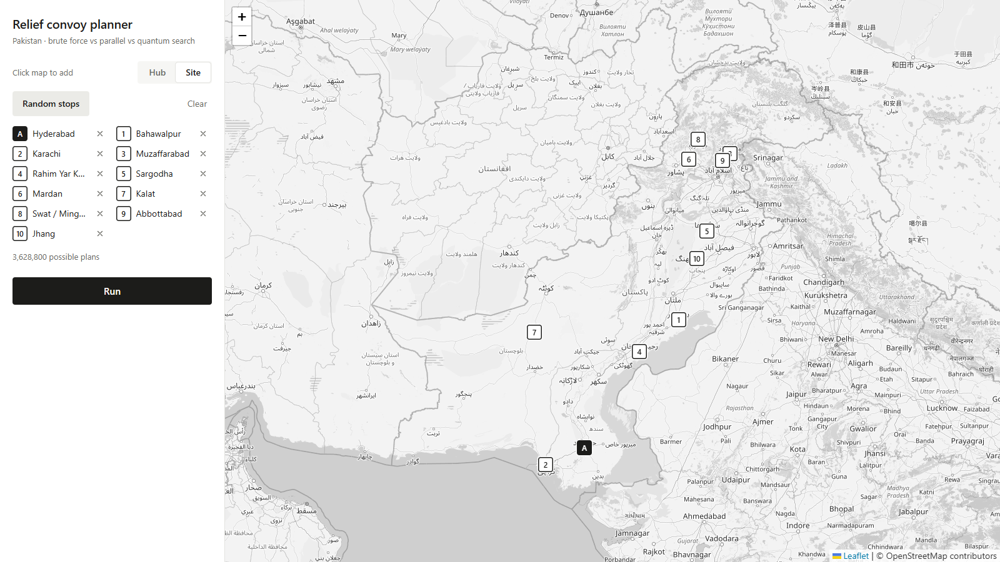
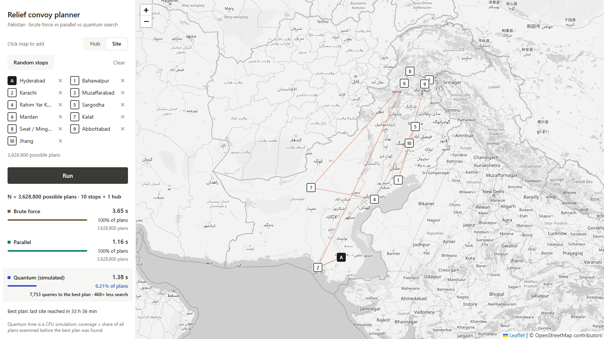
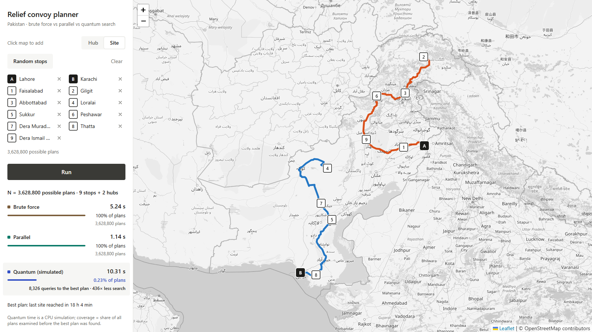
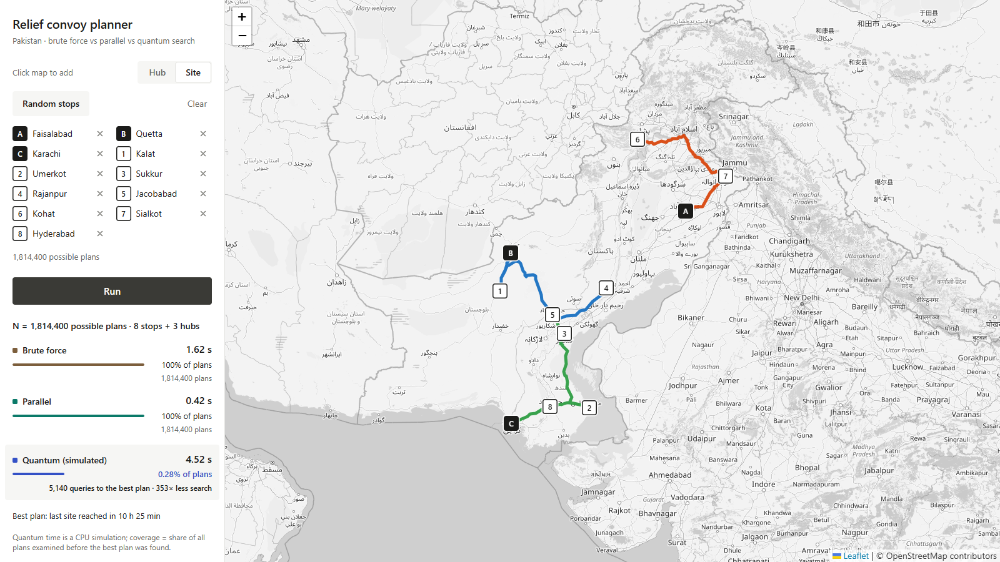

# Quantum-Routing: Quantum-Assisted Disaster Relief Routing

**Qiskit Quantum Optimization Challenge · Domain 2: Disaster Response**

When floods or an earthquake hit Pakistan, relief leaves a few logistics hubs and has to reach many stricken towns spread across the country. Each convoy's stop order, and which hub serves which town, decide how long the **last** town waits for aid. With a few hubs and ten towns there are millions of possible plans.

The app lets you place hubs and sites on a map of Pakistan, or generate a random scenario. It then finds the best plan three ways and compares how much of the plan space each had to examine:

| Method | How it finds the best plan |
|---|---|
| **Brute force** | Evaluates every possible plan (vectorised NumPy) |
| **Parallel** | Same exhaustive evaluation, split across 8 worker processes |
| **Quantum (simulated)** | **Dürr–Høyer minimum finding**: Grover search with the BBHT schedule over an index register of ⌈log₂ N⌉ qubits (21–22 qubits here) |

> Simulator proof of concept. **No quantum speedup in wall-clock time is claimed.** The quantum stage runs as a classical simulation, so its time is shown honestly. Its advantage is in **coverage**: the share of all possible plans it had to examine before holding the optimum.

## Demo


▶ **[Full video (MP4, 79 s)](docs/media/planner_demo.mp4)**: three random scenarios with 1, 2 and 3 convoys.

| Random stops | Quantum search flashing candidate plans | Result (2 convoys) | Result (3 convoys) |
|---|---|---|---|
|  |  |  |  |

Results from the recorded runs (all three methods found the same optimal plan every time):

| Scenario | Possible plans N | Brute force | Parallel | Quantum (simulated) | Quantum coverage | Less search |
|---|---|---|---|---|---|---|
| 1 hub (Hyderabad) + 10 sites | 3,628,800 | 3.65 s · 100% | 1.16 s · 100% | 1.38 s · 7,753 queries | **0.21%** | **468×** |
| 2 hubs (Lahore, Karachi) + 9 sites | 3,628,800 | 5.24 s · 100% | 1.14 s · 100% | 10.31 s · 8,326 queries | **0.23%** | **436×** |
| 3 hubs (Faisalabad, Quetta, Karachi) + 8 sites | 1,814,400 | 1.62 s · 100% | 0.42 s · 100% | 4.52 s · 5,140 queries | **0.28%** | **353×** |

Times were measured while the screen was being recorded, so they are slower than unrecorded runs. Quantum time is the cost of simulating the search on a CPU, not quantum hardware time.

## Why quantum matters at disaster scale

- **The plan space explodes.** For n sites and k convoys, N = n! · C(n+k−1, k−1): 1.8–3.6 million plans for 8–10 sites, and about 10¹⁸–10²¹ for 20 sites.
- **Classical brute force must check all N plans.** Grover-based minimum search needs about √N oracle queries. In the runs above it held the optimum after examining 0.2–0.3% of the plans, about 350–470× less search, and the gap grows with the square root of N.
- **Random scenarios are built to show this regime.** "Random stops" draws 1–3 hubs from different provinces and 8–10 sites spread across at least 3 regions. It only produces configurations with 1.5–4 million plans.
- **Break-even.** Grover would beat this CPU on hardware if one oracle query (evaluating a plan's cost reversibly) took less than roughly brute-force time ÷ queries. That is about 300–630 µs in these runs.

**How the quantum part is simulated.** At 21–22 qubits with thousands of Grover iterations, we use the **exact closed-form Grover measurement statistics**: P(marked) = sin²((2j+1)θ) with sin θ = √(M/2^q), and outcomes uniform within the marked and unmarked sets. This is exactly the circuit's output distribution, and a unit test checks it against Qiskit statevector simulation of the real Grover circuit. Instances of 12 qubits or fewer run the actual Qiskit circuit.

**What this does not claim:**
- The oracle uses plan costs computed classically. Building it as a reversible circuit is the open engineering problem.
- Error-correction overheads may erase quadratic speedups on early fault-tolerant machines ([Babbush et al., PRX Quantum 2021](https://arxiv.org/abs/2011.04149v1)).
- For a single convoy, Held–Karp dynamic programming (2ⁿ·n²) is the strongest exact classical method and overtakes plain Grover-over-tours beyond about 20 sites.
- Hybrid Grover + dynamic programming reaches O*(1.728ⁿ) ([Ambainis et al.](https://ar5iv.labs.arxiv.org/html/1807.05209)). See also quantum TSP search in [arXiv 2405.07129](https://arxiv.org/html/2405.07129v3) and [arXiv 2502.08853](https://arxiv.org/pdf/2502.08853).

## Problem formulation

- **Decision variables:** a plan = an assignment of each site to one convoy (hub) plus the visiting order of each convoy. It is encoded as one integer index in [0, N) = permutation rank × compositions + composition rank, which becomes the Grover index register.
- **Objective:** minimise the makespan, the time until the last site is reached = max over convoys of route travel time, plus 0.001 × total travel time as a tie-break.
- **Constraints:** every site is visited exactly once by exactly one convoy, and each convoy starts at its hub (open routes).
- **Data:** road travel times between all points come from the open [OSRM](https://project-osrm.org/) engine on OpenStreetMap data. The city pool matrix is fetched in one request and cached in `backend/data/osrm_cache/`. Final routes are drawn on real road geometry.

## Setup and running

Requirements: [uv](https://docs.astral.sh/uv/) (installs Python 3.12 automatically) and Node.js 18+.

```bash
# Terminal 1: backend API
cd backend
uv sync
uv run qroute-server          # http://127.0.0.1:8000

# Terminal 2: frontend
cd frontend
npm install
npm run dev                   # open http://localhost:5173
```

In the app, press **Random stops**, or pick **Hub** / **Site** and click the map. Then press **Run**. Limits: 1–3 hubs, 2–10 sites, N ≤ 4,000,000. Points you click yourself need a live OSRM request; random scenarios use the cached city matrix.

Other commands (from `backend/`):

```bash
uv run pytest                 # 18 unit tests
uv run qroute-cases           # three documented disaster cases (Sindh 2022, Pakistan 3 hubs, Türkiye–Syria 2023) → backend/results/cases/
uv run qroute-demo            # evacuation QAOA study (RAPTOR + QAOA, penalty vs XY mixer) → backend/results/
uv run qroute-report          # rebuild report/Quantum_Evacuation_Routing_Report.docx
```

Record the demo again with both servers running: `cd frontend && node scripts/record-demo.mjs`. Chrome must be installed; run `npx playwright-core install ffmpeg` once.

## Repository layout

```
backend/src/qroute/
  server.py      FastAPI: /api/random, /api/run, /api/cases, /api/solve-geo
  pool.py        49 Pakistani cities (8 hubs), cached OSRM matrix, random scenario generator
  run.py         run_plan: brute force, parallel, quantum + road geometry for the best plan
  vrp.py         plan indexing, vectorised evaluation, parallel brute force, Dürr–Høyer search
  geo.py         OSRM table/route client with caching and haversine fallback
  grover_min.py  Grover circuit (Qiskit) used for small instances and to verify the closed form
  cases.py       three documented disaster cases
  raptor.py, model.py, qaoa.py, cluster.py, baselines.py, network.py, run_demo.py, report.py
                 evacuation QAOA study (RAPTOR transit routing + QUBO + QAOA), see report/
  roadgraph.py, solvers.py   Karachi street-level road graph and solvers (earlier prototype)
backend/tests/   pytest (Grover closed form vs Qiskit, plan bijection, Ising mapping, XY mixer, ...)
frontend/src/    App.jsx (sidebar), PlanMap.jsx (map + playback), theme.js, mock.js (dev-only fallback)
docs/media/      demo video, GIF and screenshots
report/          Quantum_Evacuation_Routing_Report.docx (QAOA study)
```

## Also in the repository: evacuation QAOA study

RAPTOR transit routing combined with QAOA assigns evacuee groups to bus journeys, trading travel time against bus crowding and shelter load. On a 12-qubit instance, XY-mixer QAOA keeps 100% of samples feasible against 39–98% for penalty QAOA. It samples the exact optimum 7–17% of the time, against 1.2% for a random guess. Clustered XY-QAOA reaches the exact optimum of a 36-variable city instance. Details and limitations are in the report and `backend/results/run_log.txt`.

## Limitations

- All quantum results come from classical simulation.
- The oracle is emulated from classically computed costs, and no hardware resource estimate is made.
- Travel times are free-flow OSRM estimates. They ignore flood-closed roads, which a real deployment would need from live damage data.
- City coordinates are city centres snapped to the nearest road.
- Parallel speedup is limited by process overheads.
- Wall-clock comparisons depend on the machine and its load.

## Credits

Dürr & Høyer (1996), BBHT (1998), Grover (1996). QAOA: Farhi et al. (2014). XY mixer: Hadfield et al. (2019). CVaR: Barkoutsos et al. (2020). RAPTOR: Delling, Pajor & Werneck (2015). Held–Karp (1962). Built with Qiskit, Qiskit Aer, FastAPI, React and Leaflet. Road data, routing and map tiles © [OpenStreetMap](https://www.openstreetmap.org/copyright) contributors (ODbL), routing by OSRM. All code was written for this project; no tutorial code was copied.
