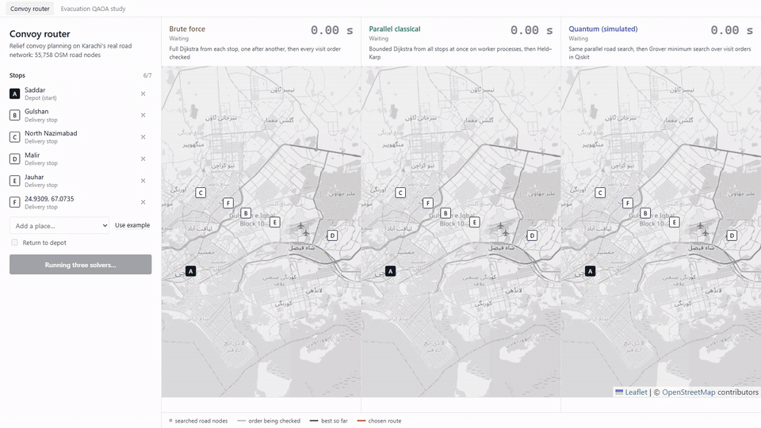
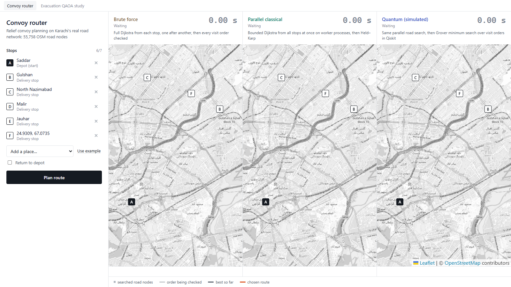
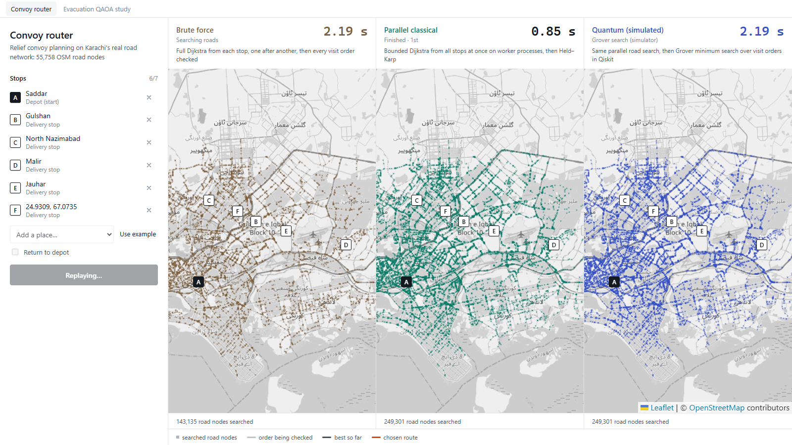
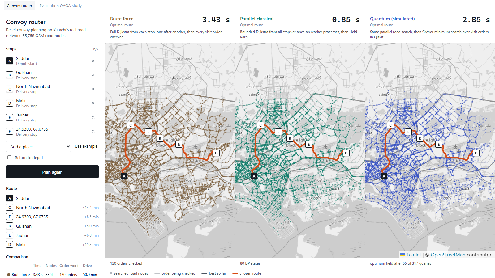
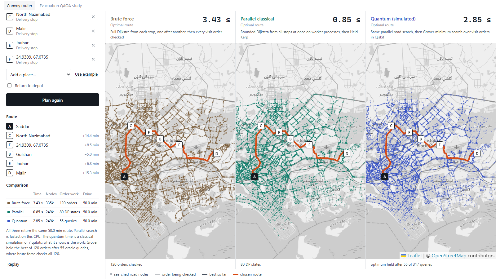

# Quantum-Routing: Quantum-Assisted Disaster Routing for Karachi

**Qiskit Quantum Optimization Challenge · Domain 2: Disaster Response**

A cyclone storm surge floods Karachi's coastal belt. Relief convoys must reach several shelters, and evacuees must be moved inland without overloading the same buses and shelters. This repository contains two parts that share one codebase:

1. **Convoy router** (interactive). Pick a depot and any number of shelters on the real OpenStreetMap road network of Karachi. Three solvers plan the delivery order and race each other live: **brute force**, **parallel classical**, and **quantum (Grover minimum search, simulated in Qiskit)**.
2. **Evacuation QAOA study**. RAPTOR transit routing combined with QAOA (penalty vs XY-mixer) assigns evacuee groups to bus journeys so that travel time, bus crowding and shelter overload are jointly minimised. Results are checked against exact brute force.

> Simulator proof of concept. **No quantum speedup is claimed.** On a CPU the quantum stage is a classical simulation, so its wall-clock time is shown honestly next to the hardware-independent work counts.

## Demo



▶ **[Full walkthrough video (MP4, 54 s)](docs/media/convoy_router_demo.mp4)**: an A→B run, then a six-stop convoy entered from the place list and by clicking the map.

| Stops entered (place list + map click) | The race: each search spreads at its measured speed |
|---|---|
|  |  |
| **Chosen route, identical for all three** | **Itinerary and comparison** |
|  |  |

### What the convoy router shows

Each panel replays one solver on the same map:

| Solver | Road search (phase 1) | Visit order (phase 2) |
|---|---|---|
| **Brute force** | Full Dijkstra from every stop, one after another, over all 55,758 road nodes | Every one of the (n−1)! visit orders is evaluated |
| **Parallel classical** | Dijkstra from all stops **at the same time** on a pool of worker processes, each stopping once the other stops are reached | Held–Karp dynamic programming (exact) |
| **Quantum (simulated)** | Same parallel road search | **Dürr–Høyer minimum finding**: Grover search with the BBHT schedule over an index register of ⌈log₂ (n−1)!⌉ qubits, simulated with Qiskit |

The replay has three acts:
1. **The race.** Each panel's search dots spread at a speed proportional to its measured wall-clock time, and its stopwatch stops at the real value.
2. **Visit order.** Brute force flips through every candidate order, Held–Karp counts its DP states, and Grover shows each measured order while it keeps the best so far.
3. **The route.** The chosen route draws itself.

Example run from the video (depot at Saddar plus 5 stops, 120 possible orders):

| | Time | Road nodes searched | Order work | Drive time |
|---|---|---|---|---|
| Brute force | 3.43 s | 335k | 120 orders evaluated | 50.0 min |
| Parallel classical | **0.85 s** | 249k | 80 DP states | 50.0 min |
| Quantum (simulated) | 2.85 s | 249k | optimum held after **55 oracle queries** | 50.0 min |

All three find the same optimal route. Parallel classical is fastest in wall-clock time. The quantum stage is slow because it is simulated, but it reached the optimum after fewer oracle queries (55) than the 120 orders brute force must check. Grover's query count grows with √N against N, which is the scaling the method offers. Dürr–Høyer cannot detect that it has the minimum, so it runs to its full O(√N) query budget; at this size the full budget (317 queries) is still larger than N.

## Repository layout

```
backend/                 Python package (uv)
  data/karachi_roads.json   OSM major-road graph of Karachi (55,758 nodes), © OpenStreetMap contributors (ODbL)
  src/qroute/
    roadgraph.py         Overpass download → compact road graph, Dijkstra
    solvers.py           brute force / parallel (process pool + Held–Karp) / quantum (Dürr–Høyer in Qiskit)
    server.py            FastAPI: /api/info, /api/solve
    network.py           synthetic Karachi transit network for the evacuation study
    raptor.py            RAPTOR router (Delling et al.), written from the paper
    model.py             evacuation model → QUBO → Ising (SparsePauliOp)
    qaoa.py              penalty & XY-mixer QAOA, CVaR training, Aer sampling
    cluster.py           cluster decomposition for large instances
    grover_min.py        Dürr–Høyer quantum minimum finding
    baselines.py         brute force, greedy, simulated annealing
    run_demo.py          evacuation experiments → results.json
    report.py            builds the .docx report and figures
  tests/                 pytest
frontend/                React + Vite + Leaflet
  src/App.jsx, RaceMap.jsx, DotLayer.js   convoy router (race UI)
  src/Study.jsx                           evacuation QAOA study dashboard
  scripts/record-demo.mjs                 drives the UI in headless Chrome and records the demo
docs/media/              demo video, GIF and screenshots
report/                  Quantum_Evacuation_Routing_Report.docx + figures
```

## Setup and running

Requirements: [uv](https://docs.astral.sh/uv/) (installs Python 3.12 automatically) and Node.js 18+.

```bash
# Terminal 1: backend API (loads the road graph and starts the worker pool)
cd backend
uv sync
uv run qroute-server          # http://127.0.0.1:8000

# Terminal 2: frontend
cd frontend
npm install
npm run dev                   # open http://localhost:5173
```

In the app, click any map to place the depot **A**, then each stop (or use **Add a place…** / **Use example**), and press **Plan route**. Tick *Return to depot* for a round trip. Up to 7 stops are supported (6! = 720 orders, a 10-qubit index register).

Other commands (from `backend/`):

```bash
uv run pytest                 # unit tests
uv run qroute-demo            # re-run the evacuation QAOA experiments (~8 min) → results.json
uv run qroute-report          # rebuild the .docx report
uv run python -m qroute.roadgraph   # re-download OSM roads and rebuild the graph cache
```

To record the demo again, start both servers, then run `node scripts/record-demo.mjs` in `frontend/`. Chrome must be installed; run `npx playwright-core install ffmpeg` once.

## Evacuation QAOA study: headline results

Open the **Evacuation QAOA study** tab in the app. Full numbers are in `backend/results/run_log.txt` and the report.

12-qubit instance (4 groups × 3 journeys, 81 feasible assignments, 4096 shots):

| QAOA | P(feasible) | P(optimal) | Approx. ratio |
|---|---|---|---|
| Penalty p=1 / 2 / 3 | 39% / 58% / 98% | 0.6% / 0.7% / 1.3% | 0.52 |
| **XY-mixer p=1 / 2 / 3** | **100% / 100% / 100%** | **15.1% / 6.7% / 16.8%** | 0.79–0.86 |

- A random feasible guess finds the optimum 1.2% of the time. The coordinated optimum is 1.44% better than uncoordinated routing (everyone taking their fastest RAPTOR journey).
- 36-variable city instance: **clustered XY-QAOA reaches the exact optimum (0.00% gap)**. Greedy is 1.61% worse, and even worse than no coordination (1.03%).
- Dürr–Høyer over RAPTOR labels: about 25 oracle queries to reach the minimum at N=64, against 63 classical comparisons.

## Limitations

- All quantum results come from classical simulation; wall-clock times for the quantum stage reflect the simulator, not quantum hardware.
- The Grover oracle is a diagonal phase gate built from tour costs computed classically. A real advantage would need those costs computed reversibly on-chip, which we did not build.
- The road graph is undirected (one-way restrictions are ignored) and uses free-flow speeds by road class. It also covers major roads only (motorway to tertiary).
- Parallel speedup is limited by process start and data transfer overheads, and by stops far apart (bounded searches then cover most of the city).
- Evacuation study timetables, capacities and group sizes are synthetic; landmark coordinates are real.

## Credits

RAPTOR: Delling, Pajor & Werneck (2012/2015). QAOA: Farhi et al. (2014). XY mixer: Hadfield et al. (2019). CVaR: Barkoutsos et al. (2020). Minimum finding: Dürr & Høyer (1996), BBHT (1998). Held–Karp: Held & Karp (1962). Route-choice QUBO idea inspired by Neukart et al. (2017). Built with Qiskit, Qiskit Aer, FastAPI, React and Leaflet. Road data and map tiles © [OpenStreetMap](https://www.openstreetmap.org/copyright) contributors (ODbL). All code was written for this project; no tutorial code was copied.
