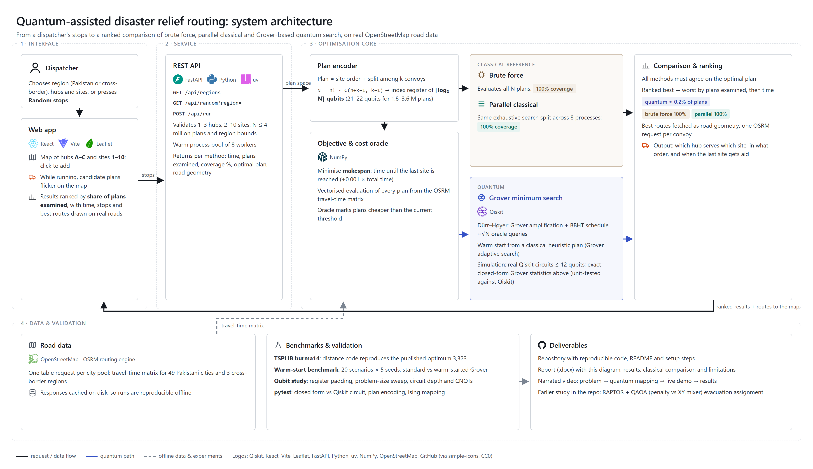
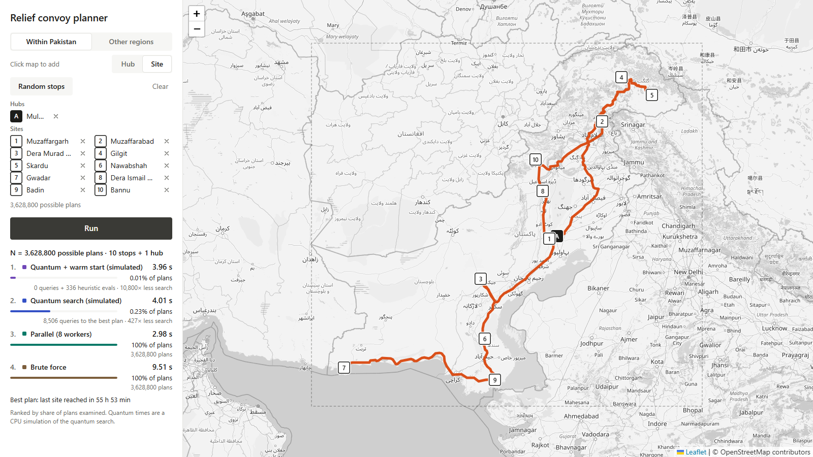
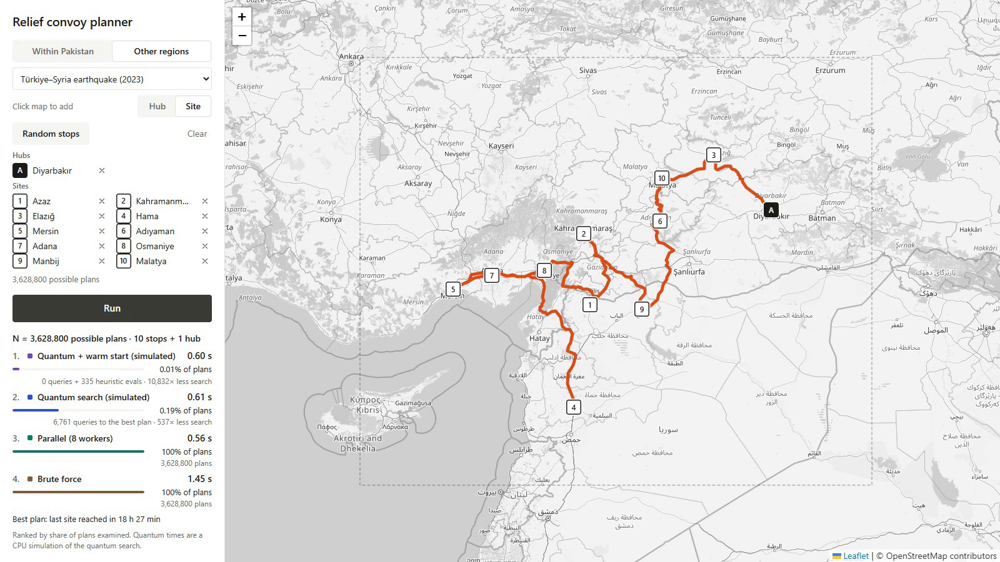

# Quantum-Routing: Quantum-Assisted Disaster Relief Routing

**Qiskit Quantum Optimization Challenge · Domain 2: Disaster Response**

When floods or an earthquake strike, relief leaves a few logistics hubs and must reach many stricken towns. Which hub serves which town, and in what order, decides how long the **last** town waits for aid. With 1–3 hubs and 8–10 towns there are **1.8–3.6 million possible plans**. This project searches that plan space with **Grover-based minimum search (Dürr–Høyer) in Qiskit**, on real OpenStreetMap roads, in four regions covering six countries, and compares it honestly with brute force, parallel brute force and exact dynamic programming.

## What to upload (submission checklist)

| # | Required item | Where it is | Notes |
|---|---|---|---|
| 1 | **GitHub repository** with reproducible Qiskit code | https://github.com/MARafey/Quantum-Routing | The last commit before the deadline is what is judged. Do not push after it. |
| 2 | **Report** (.docx; PDF copy included) | [`report/Quantum_Relief_Routing_Report.docx`](report/Quantum_Relief_Routing_Report.docx) · [PDF](report/Quantum_Relief_Routing_Report.pdf) | Results, classical comparison, limitations, qubit study |
| 3 | **Architecture diagram** (inside the report) | Report section 4 · [`docs/architecture/architecture.png`](docs/architecture/architecture.png) | Logos, icons and data flows |
| 4 | **3-minute video** (pitch and demo) | [`docs/media/submission_video.mp4`](docs/media/submission_video.mp4), 146 s | Upload to Google Drive, set access to **"anyone with the link"**, and paste that link into the form |

Before submitting: open every link in a private window, and confirm the video plays without signing in. The narration was generated locally with Pocket TTS; the model, its environment and the voice files are **not** in this repository.

> **Simulator proof of concept.** No quantum speedup in wall-clock time is claimed. The quantum stage is a classical simulation. Its advantage is in the **work done**: the share of all plans it examines before holding the optimum.

## Architecture



## Demo


▶ **[Full narrated video (MP4, 146 s)](docs/media/submission_video.mp4)**: the problem, why it explodes, where quantum is applied, the live planner on Pakistan and the Türkiye–Syria border region, and what we measured and claim.

| Pakistan | Türkiye–Syria (cross-border) |
|---|---|
|  |  |

While a run is in progress, candidate plans flicker across the map. When it finishes, the results are ranked by share of plans examined and the best routes draw along real roads.

## The three ways of searching

| Method | How it finds the best plan |
|---|---|
| **Brute force** | Evaluates every possible plan (vectorised NumPy) |
| **Parallel** | The same exhaustive evaluation, split across 8 worker processes |
| **Quantum (simulated)** | **Dürr–Høyer minimum finding**: Grover search with the BBHT schedule over an index register of ⌈log₂ N⌉ qubits (21–22 here), optionally **warm-started** by a classical heuristic plan |
| *Reference:* **Subset DP** | Exact classical dynamic programming (Held–Karp per convoy plus a min–max combine). A *stronger* classical baseline than brute force. |

## Results

Fixed-seed random scenarios, one per region, run through the same code path as the web app (`uv run qroute-regions` → `backend/results/region_runs.json`). All methods found the optimal plan in every run.

| Region | Hubs × sites | Plans N | Qubits | Brute force | Parallel | Subset DP (exact classical) | Quantum (sim.) | Quantum + warm start (sim.) |
|---|---|---|---|---|---|---|---|---|
| Pakistan floods | 2 × 9 | 3,628,800 | 22 | 0.64 s · 100% | 0.31 s · 100% | 20 ms · 2.8% | 1.42 s · **0.23%** (8,326 queries) | 0.77 s · **0.150%** (5,096 + 354 heuristic) |
| Türkiye–Syria earthquake | 1 × 10 | 3,628,800 | 22 | 3.15 s · 100% | 1.91 s · 100% | 35 ms · 2.8% | 1.21 s · **0.19%** (6,761 queries) | 1.23 s · **0.009%** (0 + 335 heuristic) |
| Bengal floods (Bangladesh + India) | 3 × 8 | 1,814,400 | 21 | 0.18 s · 100% | 0.10 s · 100% | 41 ms · 3.4% | 0.60 s · **0.20%** (3,681 queries) | 0.58 s · **0.201%** (3,499 + 141 heuristic) |
| Nepal–India Himalaya quake | 3 × 8 | 1,814,400 | 21 | 0.17 s · 100% | 0.09 s · 100% | 37 ms · 3.4% | 0.70 s · **0.22%** (4,043 queries) | 0.75 s · **0.186%** (3,065 + 303 heuristic) |

Each cell is wall-clock time · share of the N plans examined. Quantum times are the cost of simulating the search on a CPU, not quantum-hardware time.

**What the numbers say, honestly**

- **Against exhaustive search the quantum search wins clearly:** about 0.2% of plans examined, roughly 440–540× fewer in these single-seed runs (medians over 20 seeds: 620–780× at 3.6 million plans), and the gap grows with the square root of N (measured fit: queries ≈ 3.5·√N over 13 real instances, N = 24 … 3.6 million).
- **Against exact subset DP it does not:** DP solves every instance in 20–41 ms. By step count, plain Grover over the plan index needs fewer steps than DP only up to about **16–17 sites**; beyond that DP wins. The claim is a quadratic query reduction over *unstructured* search, not a practical advantage. Hybrid Grover + DP algorithms ([Ambainis et al.](https://ar5iv.labs.arxiv.org/html/1807.05209)) are the route to a real advantage.
- **The warm start helps, but mostly because the classical heuristic is good:** it lowers total coverage 12–18× (median over 20 Pakistan scenarios × 5 seeds, and 5 × 5 for each other region), mainly because the heuristic already finds the optimum in 65–100% of scenarios. When it misses, the warm-started search needs only 1.2–1.8× fewer queries (`uv run qroute-bench` → `backend/results/quantum_warmstart_benchmark.json`).

### How many qubits, and what changes with the count

The index register uses q = ⌈log₂ N⌉ qubits: **21–22** for the instances above (`uv run qroute-qubits` → `backend/results/qubit_study.json`).

| Experiment | Finding |
|---|---|
| **Padding the register** with 1–4 extra qubits (3 instances, 30 seeds) | The minimal register is optimal. Each extra qubit multiplies queries by about **1.4×** (+4 qubits gave 3.5–4.2×); success stayed 100%. |
| **Problem-size sweep**, 5 to 22 qubits (13 instances, 20 seeds) | Advantage over exhaustive search grows from 1.7× at N = 24 to **623–776×** at N = 3.6 million; none at tiny N. |
| **Circuit cost**, 3 to 12 qubits (real Qiskit, transpiled) | CNOTs per Grover iteration grow about 1.9× per qubit (12 at q = 3, 4,536 at q = 12), dominated by the generic oracle stand-in. Statevector memory doubles per qubit, which is why 21–22 qubits use exact closed-form statistics. |
| **Encoding comparison** | Index register 22 qubits vs one-hot n² = 100 (1 convoy, 10 sites). Published Grover-style TSP work: 31 qubits for 7 nodes. The index register needs 13 for the same size, but moves work into a reversible cost oracle that is not built here. |

### External check: TSPLIB burma14

Our TSPLIB distance code and Held–Karp reproduce the published optima **3,323 (burma14)** and **6,859 (ulysses16)**. On burma14 prefixes, Grover finds the optimum in 100% of runs with 2.7× fewer queries than enumeration at 5 cities and about 800× fewer at 11 cities (3.6 million tours, 22 qubits against 121 one-hot). The warm start only helps at n = 5 (`uv run qroute-tsplib`).

## How the quantum part is simulated

At 21–22 qubits and thousands of Grover iterations, we use the **exact closed-form Grover measurement statistics**: P(marked) = sin²((2j+1)θ) with sin θ = √(M/2^q), and outcomes uniform within the marked and unmarked sets. This is exactly the circuit's output distribution, and a unit test checks it against Qiskit statevector simulation of the real Grover circuit. Instances of 12 qubits or fewer run as actual Qiskit circuits.

## Problem formulation

- **Decision variables:** a plan = an assignment of each site to one convoy (hub) plus the visiting order of each convoy, encoded as one integer in [0, N), N = n! · C(n+k−1, k−1). That integer is the Grover index register.
- **Objective:** minimise the **makespan**, the time until the last site is reached = max over convoys of route travel time, plus 0.001 × total travel time as a tie-break.
- **Constraints:** every site is visited exactly once by exactly one convoy; each convoy starts at its hub (open routes); 1–3 hubs, 2–10 sites, N ≤ 4,000,000 in the demonstrator.
- **Data:** road travel times from the open [OSRM](https://project-osrm.org/) engine on OpenStreetMap data, cached in `backend/data/osrm_cache/`. Final routes are drawn on real road geometry.

## Setup and running

Requirements: [uv](https://docs.astral.sh/uv/) (installs Python 3.12 automatically) and Node.js 18+.

```bash
# Terminal 1: backend API
cd backend
uv sync
uv run qroute-server          # http://127.0.0.1:8000

# Terminal 2: frontend
cd frontend
npm install
npm run dev                   # open http://localhost:5173
```

In the app, choose **Within Pakistan** or **Other regions** (Türkiye–Syria, Bengal, Nepal–India), press **Random stops** or click the map to place hubs and sites, then press **Run**. Points you click yourself need a live OSRM request; random scenarios use the cached city matrices.

On Windows, if the server fails at startup with an OpenBLAS memory error, set `OPENBLAS_NUM_THREADS=1` before `uv run qroute-server`.

Other commands (from `backend/`):

```bash
uv run pytest                 # unit tests
uv run qroute-regions         # the table above → results/region_runs.json
uv run qroute-bench           # warm-start benchmark
uv run qroute-qubits          # qubit study
uv run qroute-tsplib          # TSPLIB burma14 / ulysses16 benchmark (slow: ~15 min)
uv run qroute-cases           # three documented disaster cases → results/cases/
uv run qroute-demo            # earlier evacuation QAOA study → results/
uv run qroute-report          # rebuild report/Quantum_Relief_Routing_Report.docx
```

To make the PDF, run `powershell -File report/to_pdf.ps1` (needs Microsoft Word). To rebuild the diagram: `cd docs/architecture && npm i simple-icons@13.21.0 playwright-core && node build_diagram.mjs`. The video recorder (`docs/video/record_video.mjs`) and assembler (`docs/video/assemble.sh`) need Chrome, ffmpeg and locally generated narration.

## Repository layout

```
backend/src/qroute/
  server.py        FastAPI: /api/regions, /api/random, /api/run, /api/cases, /api/solve-geo
  pool.py, regions_data.py   49 Pakistani cities + 3 cross-border regions, cached OSRM matrices, random scenarios
  run.py           run_plan: brute force, parallel, quantum, quantum + warm start, road geometry
  vrp.py           plan indexing, vectorised evaluation, parallel brute force, Dürr–Høyer search, warm start
  dp_baseline.py   exact subset dynamic-programming baseline
  geo.py           OSRM client with caching and haversine fallback
  grover_min.py    Grover circuit (Qiskit), used for small instances and to verify the closed form
  bench_ws.py, qubit_study.py, tsplib_bench.py, region_runs.py   benchmarks → backend/results/*.json
  final_report.py, report_figs.py   builds the report from the result files
  raptor.py, model.py, qaoa.py, cluster.py, baselines.py, network.py, run_demo.py   evacuation QAOA study
  roadgraph.py, solvers.py         Karachi street-level prototype
backend/tests/     pytest
frontend/src/      App.jsx (sidebar), PlanMap.jsx (map + playback), theme.js, mock.js (dev-only fallback)
docs/architecture/ architecture diagram (PNG, HTML, generator)
docs/media/        submission video, GIF, screenshots
docs/video/        animated scenes, recorder and assembler for the video
report/            report (.docx and .pdf), figures, to_pdf.ps1
```

## Also in the repository: evacuation QAOA study

An earlier approach routed evacuee groups over a synthetic bus network on Karachi's real coordinates: RAPTOR transit routing, then a QUBO solved with QAOA. On a 12-qubit instance, the XY-mixer QAOA keeps 100% of samples feasible against 39–98% for penalty QAOA, and samples the exact optimum 7–17% of the time against 1.2% for a random guess. Clustered XY-QAOA reaches the exact optimum of a 36-variable instance. See Appendix A of the report.

## Limitations

- All quantum results come from classical simulation; above 12 qubits the search uses exact closed-form Grover statistics.
- The oracle is emulated from classically computed plan costs. No reversible cost circuit, ancilla count or fault-tolerant resource estimate is given, and error-correction overhead may cancel a quadratic speedup ([Babbush et al., 2021](https://arxiv.org/abs/2011.04149v1)).
- Brute force is a weak baseline. Exact subset DP is faster in wall-clock time and, beyond about 16–17 sites, in step count.
- The warm start's gain is mostly the classical heuristic's own accuracy.
- Travel times are free-flow OSRM estimates between city centres. Flooded roads, vehicle capacity, relief quantities and time windows are not modelled.
- Statistics: one seeded scenario per region in the results table; 20–30 seeds per cell in the studies.

## Credits

Dürr & Høyer (1996), BBHT (1998), Grover (1996), Gilliam et al. (2021, Grover adaptive search). QAOA: Farhi et al. (2014). XY mixer: Hadfield et al. (2019). CVaR: Barkoutsos et al. (2020). RAPTOR: Delling, Pajor & Werneck (2015). Held–Karp (1962), TSPLIB (Reinelt, 1991). Built with Qiskit, Qiskit Aer, FastAPI, React and Leaflet. Road data, routing and map tiles © [OpenStreetMap](https://www.openstreetmap.org/copyright) contributors (ODbL), routing by OSRM. Logos from [simple-icons](https://simpleicons.org/) (CC0). Narration by Pocket TTS (Kyutai), generated locally. All code was written for this project; no tutorial code was copied.
